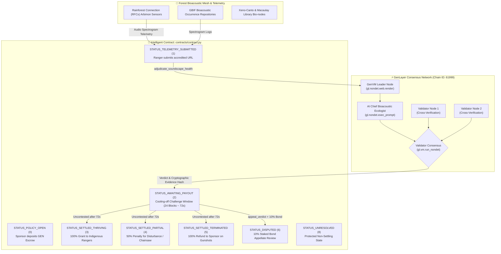

# 🌿 AgentBioAcoustic: Protocol Architecture & Technical Specification

> **Autonomous Rainforest Biodiversity Soundscape & Poaching Defense Oracle on GenLayer StudioNet**

---

## 📌 Executive Summary

**AgentBioAcoustic** is a decentralized, autonomous Regenerative Finance (ReFi) and ecological soundscape verification protocol deployed as an Intelligent Contract on **GenLayer StudioNet** (Chain ID: `61999`, Hex: `0xF22F`).

Traditional biodiversity credits and conservation grant programs suffer from severe verification blind spots. Satellite optical imagery is rendered useless under dense cloud cover or thick rainforest canopy, while camera traps provide narrow angles of view and are easily vandalized. 

AgentBioAcoustic leverages **DePIN bioacoustic sensor arrays** (e.g. AudioMoth, OpenSoundscape, Rainforest Connection Guardian units) that stream high-fidelity acoustic spectrogram telemetry directly to GenLayer. Multi-validator on-chain AI consensus ingests raw audio logs via non-deterministic web rendering (`gl.nondet.web.render`), computing the **Normalized Difference Soundscape Index (NDSI)**, detecting chainsaw engine harmonics (100–500 Hz), and flagging ballistic gunshot acoustic rise-time impulses (>120 dB) to autonomously disburse conservation subsidies or trigger emergency poaching freezes.

---

## 🏛️ System Architecture Diagram

---

## 🔄 State Machine & Verdict Decision Matrix

The protocol transitions strictly between 9 deterministic states:

| Status Code | Status Name | Description |
|---|---|---|
| `0` | `STATUS_POLICY_OPEN` | Sponsor locked conservation escrow. Awaiting initial telemetry submission. |
| `1` | `STATUS_TELEMETRY_SUBMITTED` | Registered ranger station submitted valid bioacoustic stream link. |
| `2` | `STATUS_AWAITING_PAYOUT` | AI Bioacoustic Jury rendered verdict. 24-block (~72s) challenge window active. |
| `3` | `STATUS_SETTLED_THRIVING` | Dense biophony verified. 100% of escrow disbursed to ranger station. |
| `4` | `STATUS_SETTLED_PARTIAL` | Chainsaw drone (5–59m) or degraded NDSI. 50% penalty applied. |
| `5` | `STATUS_SETTLED_TERMINATED` | Confirmed gunshots or severe soundscape collapse. 100% refunded to sponsor. |
| `6` | `STATUS_DISPUTED` | Staked appeal filed with 10% bond and supplemental high-res audio telemetry. |
| `7` | `STATUS_EXPIRED_RECLAIMED` | Coverage expired without telemetry. Escrow reclaimed by sponsor. |
| `8` | `STATUS_UNRESOLVED` | Network failure, parsing error, or canary mismatch. Protected non-settling state. |

---

## 🔬 Bioacoustic Ecological Evaluation Rubric

The GenLayer AI Tribunal evaluates soundscape health against three primary metrics:

### 1. Normalized Difference Soundscape Index (NDSI)
$$\text{NDSI} = \frac{\beta - \alpha}{\beta + \alpha}$$
Where:
- $\beta$ = Biophony acoustic energy (2,000 Hz to 8,000 Hz: birds, primates, frogs, orthoptera).
- $\alpha$ = Anthrophony acoustic energy (1,000 Hz to 2,000 Hz: vehicles, airplane flyovers, human machinery).
- Range: $[-1.0, +1.0]$, scaled on-chain to an integer score $[0, 100]$ (where $\text{Score} = 50 + 50 \times \text{NDSI}$).
- A target threshold of $\ge 60$ ($+0.20$ NDSI) certifies pristine biological dominance.

### 2. Ballistic Gunshot Peak Impulse Detection
- Identifies explosive high-energy sound pressure waves with rise time $< 5 \text{ ms}$ and peak acoustic amplitude $> 120 \text{ dB}$.
- **Rule:** $\ge 1$ detected gunshot triggers immediate `POACHING_CRISIS_TERMINATED` classification.

### 3. Industrial Chainsaw Engine Harmonics
- Identifies persistent two-stroke internal combustion engine harmonic bands (fundamental 100–150 Hz with continuous harmonic overtones up to 500 Hz).
- **Rule:** Cumulative activity between 5 and 59 minutes triggers `ANTHROPOGENIC_DISTURBANCE_PENALTY` (50% grant cut). Activity $\ge 60$ minutes triggers emergency termination.

---

## 🔒 Security Architecture

1. **Prompt Injection Canary Defense**:
   Every AI prompt requires echoing `CANARY_AGENT_BIO_ACOUSTIC_V1`. Any response omitting or tampering with this canary aborts to `STATUS_UNRESOLVED`.
2. **Domain Accreditation Check**:
   Telemetry endpoints must strictly originate from recognized life-science and conservation bioacoustic repositories (`rfcx.org`, `arbimon.rfcx.org`, `gbif.org`, `xeno-canto.org`, `macaulaylibrary.org`, `cornell.edu`, `wildlabs.net`, `opensoundscape.org`).
3. **Double-Payout Mitigation**:
   Escrow amount is cleared to zero (`p.escrow_amount = 0`) before funds are transferred.
4. **Pull-Payment Safeguard (`claim_payout`)**:
   Outbound transfers buffer into `claimable_balances` if direct recipient emission fails, preventing permanently locked funds.
