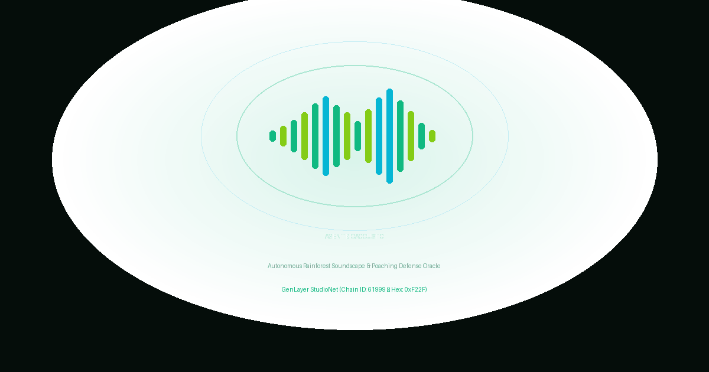

# 🌿 AgentBioAcoustic

> **Autonomous Rainforest Biodiversity Soundscape & Poaching Defense Oracle on GenLayer**

[-10B981?style=for-the-badge&logo=ethereum)](https://studio.genlayer.com)
[](LICENSE)
[](tests/)
[](contracts/)
[](frontend/)

---



---

## ⚡ The One-Line Pitch
> *"Traditional EVM smart contracts are blind and deaf to rainforest canopies, unable to listen to AudioMoth telemetry or calculate acoustic biodiversity indices. Without GenLayer's non-deterministic web rendering and multi-validator AI consensus, autonomous parametric biodiversity grants and anti-poaching defense oracles are fundamentally impossible."*

---

## 🔍 The Real-World Problem

Rainforests across Southeast Asia, the Congo Basin, and the Amazon hold over 80% of terrestrial biodiversity. Yet biodiversity credit DAOs and conservation philanthropy face severe operational roadblocks:

1. **Satellite Blind Spots & Camera Trap Bottlenecks**: Satellite optical cameras cannot penetrate cloud cover or thick multi-tiered tropical canopies. Camera traps have a narrow 50-degree field of view and are easily located and destroyed by commercial poaching syndicates.
2. **Deterministic Blockchains are Deaf**: Deterministic blockchains (Ethereum, Arbitrum, Solana) cannot ingest live audio spectrograms, parse bioacoustic telemetry, or distinguish between a cascading river torrent and an illegal logging chainsaw.
3. **Bureaucratic & Corrupt Disbursement Chains**: Grants for indigenous forest patrols often take 6 to 12 months to clear intermediaries, leaving front-line rangers without operating funds while illegal deforestation accelerates.

---

## 💡 The AgentBioAcoustic Solution on GenLayer

**AgentBioAcoustic** builds an autonomous, non-custodial Regenerative Finance (ReFi) oracle and escrow protocol on **GenLayer StudioNet**:

- **Pre-Funded Conservation Escrow (`create_conservation_policy`)**: Sponsors, Biodiversity DAOs, or Nature Funds deposit GEN into smart escrow, designating an indigenous ranger patrol and setting a minimum target **Normalized Difference Soundscape Index (NDSI)** (e.g. $\ge 65$).
- **DePIN Bioacoustic Telemetry Binding (`submit_soundscape_telemetry`)**: Rangers or IoT acoustic mesh arrays (RFCx Guardian, AudioMoth, OpenSoundscape) stream audio telemetry endpoints from **accredited life-science repositories** (`rfcx.org`, `arbimon.rfcx.org`, `gbif.org`, `xeno-canto.org`, `macaulaylibrary.org`, `opensoundscape.org`).
- **On-Chain AI Bioacoustic Jury (`adjudicate_soundscape_health`)**:
  - Ingests raw telemetry on-chain via GenLayer's non-deterministic web rendering (`gl.nondet.web.render`).
  - Computes cryptographic SHA-256 evidence digests (`p.evidence_hash`) sealing raw sensor telemetry.
  - Multi-validator AI consensus (`gl.vm.run_nondet`) evaluates three ecological dimensions:
    1. **NDSI Score (0–100)**: Assesses whether biophony (cicadas, gibbons, hornbills) dominates over anthrophony (engine rumble).
    2. **Chainsaw Drone Minutes**: Detects internal combustion harmonic drone frequencies between 100–500 Hz.
    3. **Gunshot Acoustic Impulses**: Detects sharp acoustic rise-time peaks exceeding 120 dB.
  - Renders automated consensus verdicts:
    - **`BIODIVERSITY_THRIVING_FULL`**: 100% grant disburse to indigenous ranger station.
    - **`ANTHROPOGENIC_DISTURBANCE_PENALTY`**: 50% penalty cut for illegal logging / motor disturbance.
    - **`POACHING_CRISIS_TERMINATED`**: 100% refund of escrow to sponsor upon verified gunshot impulses.
- **24-Block (~72s) Dispute Cooling Window (`appeal_verdict` & `adjudicate_appeal`)**: A 24-block dispute window allows either party to challenge a verdict by staking a **10% dispute bond** with supplemental high-definition audio logs.
- **Protected Non-Settling State (`STATUS_UNRESOLVED`)**: Unreachable feeds or canary parsing errors abort to a non-settling protected state, preventing improper payouts.
- **Pull-Payment Safeguard (`claim_payout`)**: Buffered disbursement balances eliminate stuck funds and re-entrancy risks.

---

## 🌐 Live Studionet Deployment

| Parameter | Value |
|---|---|
| **Network** | GenLayer Studionet |
| **Chain ID** | `61999` (Hex: `0xF22F`) |
| **RPC Endpoint** | `https://studio.genlayer.com/api` |
| **Contract Address** | `0x26214bB35532a4AC9F3d6c3ca2Af442eC264027F` |
| **Transaction Hash** | `0xf80bfd330ba0521559876c7406dc36ab94fdeb8e8c86595ca9e894ab4d692414` |
| **Receipt Status** | `5` (ACCEPTED / FINALIZED) |
| **GenLayer Studio View** | [View Contract on GenLayer Studio](https://studio.genlayer.com/contracts/0x26214bB35532a4AC9F3d6c3ca2Af442eC264027F) |

---

## 📁 Repository Structure

```
AgentBioAcoustic/
├── contracts/
│   └── contract.py               # GenLayer Intelligent Contract (Storage, Oracles, Jury)
├── tests/
│   ├── conftest.py               # Mock GenVM simulator fixture
│   └── test_agentbioacoustic.py  # 9 comprehensive pytest test suites (100% passing)
├── scripts/
│   ├── deploy_studionet.py       # Automated deployment script for GenLayer Studionet
│   ├── test_live_studionet.py    # Live query & verification script
│   ├── seed_demo_policy.py       # Demo policy seeder for StudioNet
│   └── generate_logo.py          # Logo & visual asset generator
├── frontend/                     # Rainforest Acoustic Radar (React 18 + Vite + TS + Tailwind)
│   ├── src/
│   │   ├── config/genlayer.ts    # Viem & genlayer-js Studionet client configuration
│   │   ├── components/
│   │   │   ├── Navbar.tsx        # Wallet connection, StudioNet switch, GEN balance
│   │   │   ├── StatsOverview.tsx # Metrics for escrow locked, habitats protected, settled grants
│   │   │   ├── CreatePolicyModal.tsx # Conservation policy builder & escrow funder
│   │   │   ├── PolicyCard.tsx    # Interactive soundscape monitoring card
│   │   │   ├── SubmitTelemetryModal.tsx # RFCx / Arbimon / GBIF audio stream submission
│   │   │   ├── AcousticInspectorModal.tsx # AI jury forensic audit & spectrogram breakdown
│   │   │   ├── AppealModal.tsx   # 24-block dispute portal with 10% staked bond
│   │   │   └── PullPayoutButton.tsx  # Pull-payment claim interface
│   │   ├── utils/formatters.ts   # Formatters for GEN, dates, addresses, statuses
│   │   └── App.tsx               # Main monitoring dashboard
│   ├── package.json
│   ├── vite.config.ts
│   └── tailwind.config.js
├── deployment.json               # Authoritative Studionet deployment receipt
├── ARCHITECTURE.md               # Detailed architectural specification & state machine
├── CHANGELOG.md                  # Release versioning history
├── SECURITY.md                   # Security model & threat vectors
└── LICENSE                       # MIT License
```

---

## 🧪 Comprehensive Test Suite (9/9 Passing)

Run the full pytest suite locally:
```bash
python -m pytest -v
```

### Verified Test Cases:
1. `test_agentbioacoustic_thriving_soundscape_full_payout`: Proves that a verified thriving soundscape releases 100% conservation grant to rangers.
2. `test_agentbioacoustic_unaccredited_source_rejected`: Proves that trigger alerts from unaccredited sources are strictly rejected.
3. `test_agentbioacoustic_anthropogenic_disturbance_penalty`: Proves that detected chainsaw or degraded NDSI cuts 50% penalty to rangers.
4. `test_agentbioacoustic_poaching_crisis_terminated`: Proves that gunshots cause emergency termination and 100% refund to sponsor.
5. `test_agentbioacoustic_cooling_off_challenge_window_blocks_early_settlement`: Proves that finalizing payout prior to the 24-block (~72s) cooling window is strictly rejected.
6. `test_agentbioacoustic_appeal_with_bond_and_overturn`: Proves that an appeal filed with 10% bond during cooling-off triggers re-evaluation and overturn.
7. `test_agentbioacoustic_unresolved_telemetry_fetch_failure`: Proves that network or parsing failures transition safely to `STATUS_UNRESOLVED` without settling.
8. `test_agentbioacoustic_cancel_or_reclaim_expired`: Proves that sponsor can reclaim escrow once coverage duration has expired with zero telemetry.
9. `test_agentbioacoustic_pull_payment_claim`: Proves that beneficiaries can safely withdraw buffered balances via pull-payment.

---

## 🚀 Getting Started

### Prerequisites
- Python 3.11+
- Node.js 18+ & npm
- MetaMask browser extension configured with GenLayer Studionet (Chain ID: `61999`)

### Running the Frontend
```bash
cd frontend
npm install
npm run dev
```

The dApp will be accessible at `http://localhost:5173`.
